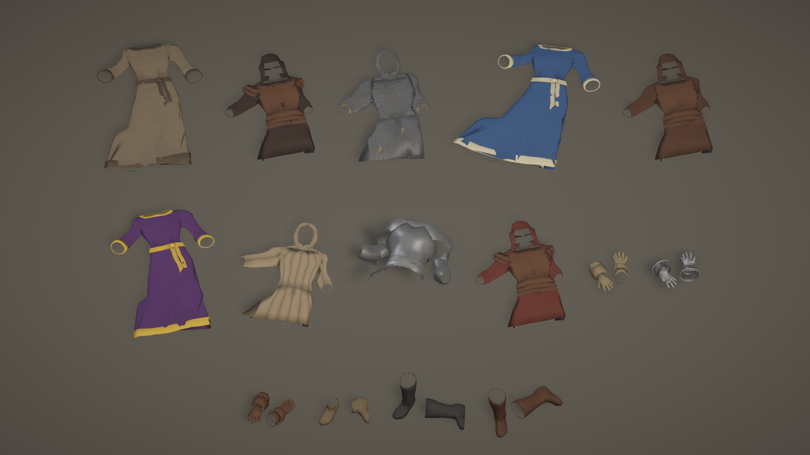

# Items

The item models and item icons of a top-down medieval RPG (MedievalSetting), built procedurally in Blender and rendered
in Unity: jewellery, potions, scrolls, tomes, gems, gold, food, herbs, crafting materials, creature parts, ammunition,
bags, and the armour as it lies on the ground. 116 models and 203 icons in all. The weapons and shields are in
[Weapons](https://github.com/danielgruginski/Weapons).

They ship as a CC0 asset pack, **Medieval Weapons & Items** on itch.io, with the weapons.

## What is here

| Path | What it does |
|---|---|
| `src/items_build.py` | Builds 101 item models from code (parts on material slots, at real size) and exports one FBX each: necklaces, berries, food, potions, scrolls, 18 tomes (3 a class + general), gems, gold piles, materials, creature parts, ammunition, bags. Run in Blender: `exec(open(r".../Items/src/items_build.py").read()); build(); export()` |
| `src/armour_drop.py` | The 15 armour pieces on the ground, made from the characters' own worn garments ([Humans](https://github.com/danielgruginski/Humans) `humans.blend`): body armour laid on its back and pressed flat with folds, plate laid but rigid, gloves and gauntlets side by side, one boot standing and one fallen. Each garment keeps its in-game colour; the result is baked into one 512 px texture with a little ground AO. Headless: `blender.exe -b --factory-startup --python src/armour_drop.py -- <item> [export] [norender]` |
| `src/glow_textures.py` | Painted backgrounds for magic items' icons. Tried in the game and taken out the same day (a faint coloured outline replaced them); kept for the record. `py src/glow_textures.py` |
| `textures/T_IT_*.png` | The armour's baked textures (512 px), as `armour_drop.py` writes them |
| `unity/ItemIconsMenu.cs` | **A copy, for reference.** The Unity editor menu that renders the icons (every weapon, shield and item model, alone in a preview scene, onto a transparent 128 px square, with a glow mask for magic items), makes the items' URP materials, and sets every item's ground model. It is part of the game project and uses its code (`ItemDefinition`, `GameRules`, `HumanActor` for armour worn on a hidden body), so it does not compile on its own. |

Not in the repo: `blender/` (the `.blend` files) and `renders/`; the scripts make them again.

## Things to know

- Paths are absolute to the author's machine (`E:/Unity/Projects/...`): `ROOT`/`OUT` at the top of each script.
- Units are metres. Each model is one object named `IT_<item id>`, its origin on the ground under it, laid in the XZ
  plane front to -Y. Materials are named `IT_<Material>` (or the village kit's `VK_<Material>` for the few on the kit's
  goods atlas, paper and bark), so Unity remaps them by name to its own; `IT_Tint` is a placeholder the game colours per
  item (a potion's draught, a scroll's seal, a gem).
- The FBX files are exported with axis forward -Z, up Y; Unity's importer (axis conversion baked) then has Blender's up
  along Unity's -Z, so the game lays each ground item on its thinnest side and the itch pack's prefabs turn the model
  upright.
- Some models were first built at a handy size and are scaled to their real longest side (`SIZE` in `items_build.py`),
  because the icons are framed by real size.

## How it was made

AI-generated: an AI coding assistant (Claude, via Claude Code) wrote the Blender and Unity scripts, directed and
reviewed by Daniel Gruginski. No image model was used.

## Licence

CC0 1.0 (see LICENSE).
